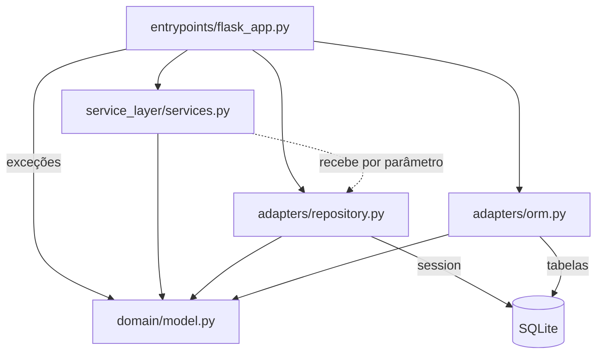

# Arquitetura do SorvGest

## 1. Escopo

O SorvGest é um sistema de gestão para uma sorveteria. Ele controla o catálogo de
sabores e seu estoque, os pedidos de venda (abertura, inclusão de itens, finalização
com baixa de estoque e cancelamento) e um programa de fidelidade em que clientes
acumulam pontos a cada compra e os resgatam depois. Os usuários são os atendentes,
que registram pedidos no balcão, e o gerente, que cadastra sabores, repõe estoque e
gerencia clientes. O acesso é feito por uma API HTTP. 
Ficam fora do escopo autenticação e controle de acesso, pagamentos e emissão de
nota fiscal, além de requisitos de desempenho e disponibilidade: o sistema atende
uma única loja, com poucos usuários simultâneos.

## 2. Requisitos arquiteturais

### 2.1 Atributos de qualidade

**QA1 — Integridade das regras de negócio**

| Parte do cenário | Descrição |
|---|---|
| Fonte | Atendente |
| Estímulo | Tenta finalizar um pedido com quantidade maior que o estoque do sabor, ou resgatar mais pontos do que o saldo do cliente |
| Ambiente | Operação normal |
| Artefato | Agregados `Pedido`, `Sabor` e `ContaFidelidade` |
| Resposta | A operação é rejeitada com um erro de negócio (HTTP 400) e nenhum dado é alterado |
| Medida | 100% das violações rejeitadas; estoque e saldo nunca ficam negativos, verificado por testes unitários e e2e |

**QA2 — Testabilidade**

| Parte do cenário | Descrição |
|---|---|
| Fonte | Desenvolvedor |
| Estímulo | Altera uma regra de negócio (por exemplo, o cálculo de pontos) e executa os testes |
| Ambiente | Desenvolvimento, sem banco de dados configurado |
| Artefato | Domínio e camada de serviço |
| Resposta | Os testes de domínio e de serviço rodam sem banco, usando repositórios falsos |
| Medida | Suíte unitária completa em menos de 1 segundo; nenhum teste unitário depende do SQLite |

**QA3 — Modificabilidade**

| Parte do cenário | Descrição |
|---|---|
| Fonte | Gerente da sorveteria |
| Estímulo | Pede uma mudança de infraestrutura (trocar SQLite por PostgreSQL) ou um novo caso de uso |
| Ambiente | Manutenção |
| Artefato | Camadas `adapters/`, `service_layer/` e `entrypoints/` |
| Resposta | A mudança fica restrita às camadas externas, sem tocar no domínio |
| Medida | Zero linhas alteradas em `domain/model.py` para trocar o banco; um novo caso de uso altera no máximo 2 arquivos de produção (`services.py` e `flask_app.py`) |

### 2.2 Restrições

- Stack imposta pela disciplina: Python 3, Flask, SQLAlchemy e pytest.
- Estrutura de pastas do Apêndice B do livro-texto.
- Banco SQLite, escolhido por não exigir um servidor.

### 2.3 Objetivos da arquitetura

- Manter as regras de negócio isoladas de frameworks, para que possam ser testadas
  e alteradas sem depender de banco ou HTTP.
- Ter uma ampla base de testes rápida que sirva de rede de segurança para as refatorações.
- Permitir trocar detalhes de infraestrutura, aumentar o escopo ou refatorar o código sem reescrever o domínio.

## 3. Arquitetura atual

### 3.1 Estilos e padrões adotados

- **Arquitetura em camadas**, com dependências apontando para dentro: entrypoints →
  serviços → domínio.
- **Ports & Adapters (parcial):** os repositórios abstratos são portas; as
  implementações SQLAlchemy e fake são adaptadores.
- **Domain Model:** as regras ficam nas entidades e agregados (`Pedido`, `Sabor`,
  `ContaFidelidade`), não nos serviços.
- **Repository:** um repositório por agregado, com três implementações cada
  (abstrata, fake em memória e SQLAlchemy).
- **Service Layer:** cada caso de uso é uma função em `services.py` que busca
  objetos nos repositórios, chama o domínio e confirma a transação.
- **Data Mapper com mapeamento imperativo:** `orm.py` liga tabelas às classes de
  domínio de fora para dentro; o domínio não importa SQLAlchemy.

### 3.2 Diagrama de componentes

As setas indicam "depende de". Nenhuma seta sai de `domain/`: o domínio não conhece
nenhuma outra camada. `services.py` importa apenas o domínio; os repositórios chegam
como parâmetros, o que permite usar os fakes nos testes.

### 3.3 Mapeamento para as pastas

| Componente | Pasta / arquivo | Responsabilidade |
|---|---|---|
| Domínio | `src/sorvgest/domain/model.py` | Entidades, objetos de valor, agregados e invariantes |
| Portas e repositórios | `src/sorvgest/adapters/repository.py` | Persistência por agregado (abstrato, fake e SQLAlchemy) |
| Mapeamento ORM | `src/sorvgest/adapters/orm.py` | Tabelas e ligação com as classes de domínio |
| Serviços | `src/sorvgest/service_layer/services.py` | 8 casos de uso e coordenação entre agregados |
| API | `src/sorvgest/entrypoints/flask_app.py` | Traduz HTTP em chamadas de serviço e erros em 400/404 |
| Testes | `tests/unit`, `tests/integration`, `tests/e2e` | Domínio e serviços; repositórios reais; API |

## 4. Análise de trade-offs

### 4.1 Contribuição da arquitetura para cada atributo

| Atributo | Como a arquitetura contribui | Como prejudica |
|---|---|---|
| QA1 Integridade | As invariantes ficam dentro dos agregados (`Sabor.baixar_estoque`, `ContaFidelidade.resgatar`), então qualquer caminho (API, teste, script) passa por elas | `Pedido.finalizar` altera o estoque de `Sabor` diretamente, atravessando a fronteira entre agregados (ver risco R1) |
| QA2 Testabilidade | Os serviços recebem repositórios por parâmetro; 11 testes de serviço rodam com fakes, sem banco | Cada agregado exige manter também um fake, que pode divergir do comportamento real |
| QA3 Modificabilidade | O domínio não importa SQLAlchemy nem Flask; trocar o banco afeta só `adapters/` e a configuração em `flask_app.py` | Um novo agregado exige tocar em 4 lugares: domínio, `orm.py`, `repository.py` e serviços |

### 4.2 Pontos de trade-off

**TP1 — Repositório abstrato + fake: testabilidade × simplicidade.**
A abstração permite testar serviços sem banco (QA2), mas custa 3 classes por agregado:
`repository.py` tem 153 linhas e 12 classes para 4 agregados. Num sistema deste
tamanho, uma parte desse código existe apenas para os testes.

**TP2 — Mapeamento imperativo: independência do domínio × produtividade.**
O domínio fica livre de infraestrutura (QA3), mas o mapeamento vive em outro arquivo
(`orm.py`, 70 linhas) e tem armadilhas: atributos privados como `_saldo` e `_itens`
precisam ser mapeados pelo nome, e erros de mapeamento só aparecem nos testes de
integração. Com modelos declarativos, isso estaria junto da classe.

**TP3 — Coordenação de agregados no serviço: desacoplamento × coesão.**
`finalizar_pedido` credita os pontos na `ContaFidelidade`, então o `Pedido` não
conhece a fidelidade. Em troca, a regra "1 ponto por real" fica na camada de serviço,
fora do domínio.

### 4.3 Riscos

**R1 — Estoque alterado por outro agregado e sem controle de concorrência.**
`Pedido.finalizar` chama `Sabor.baixar_estoque` diretamente. Dois pedidos finalizados
ao mesmo tempo podem ler o mesmo estoque e vender a mesma unidade, já que não há
bloqueio nem número de versão. Mitigação planejada: separar o estoque em seu próprio
agregado (refatoração SOLID do checkpoint 2).

**R2 — Atomicidade depende de disciplina.**
Sem Unit of Work, cada serviço chama `session.commit()` por conta própria. A
atomicidade de `finalizar_pedido` (pedido + estoque + pontos) só existe porque todos
os repositórios recebem a mesma `session`, algo fácil de quebrar ao adicionar um
caso de uso.

## 5. Alternativa: Flask com Active Record

Na alternativa, cada classe herda de `db.Model` (Flask-SQLAlchemy), as regras ficam
nos próprios modelos e as rotas chamam os modelos diretamente, sem repositórios nem
camada de serviço.

| Atributo | Arquitetura atual | Active Record |
|---|---|---|
| QA1 Integridade | Invariantes nos agregados, independentes de persistência | Invariantes também podem ficar nos modelos; porém a lógica tende a migrar para as rotas, e nada impede uma rota de alterar colunas diretamente |
| QA2 Testabilidade | Domínio e serviços testados sem banco (0,10s para os 48 testes unitários) | Quase todo teste precisa de banco e contexto Flask; a suíte se aproxima do custo dos e2e (0,61s para 4 testes) |
| QA3 Modificabilidade | Trocar banco não toca o domínio; novo agregado exige 4 arquivos | Novo agregado exige 1 modelo e rotas; trocar de ORM ou separar o domínio exige reescrever tudo |
| Simplicidade | 223 linhas em `orm.py` + `repository.py` só de infraestrutura | Sem camadas extras; o mapeamento fica na própria classe |

**Conclusão.** Para o tamanho atual do SorvGest, o Active Record seria suficiente e
mais simples. Ainda assim, eu manteria a arquitetura atual de forma simplificada: o
domínio isolado e a camada de serviço pagam o próprio custo, porque protegem as
regras de estoque e fidelidade (QA1) e permitem testes rápidos (QA2), que serão a
rede de segurança das refatorações da Fase 2. O repositório abstrato com três
implementações é a parte de menor retorno e seria a primeira a ser simplificada.
Essa avaliação será revisitada na retrospectiva.

## 6. Evidências

1. **O domínio não depende da infraestrutura.** O commit `5872095` adicionou o ORM e
   os quatro repositórios SQLAlchemy (285 linhas adicionadas em 6 arquivos), e
   `domain/model.py` mudou em apenas 3 linhas do diff: a assinatura do `__init__` e a
   atribuição do novo identificador `pedido_id` do `Pedido`.
2. **O custo da indireção é mensurável.** `orm.py` tem 70 linhas e `repository.py`
   tem 153 linhas e 12 classes (223 linhas só de infraestrutura de persistência),
   contra 102 linhas da camada de serviço inteira.
3. **Os fakes tornam os testes rápidos.** A suíte unitária (48 testes, incluindo os
   11 de serviço com repositórios fake, commit `6d51c28`) roda em 0,10 s, cerca de
   2 ms por teste; os 4 testes e2e, que passam por Flask e SQLite, levam 0,61 s,
   cerca de 150 ms por teste, ou seja, uns 70 vezes mais lentos.
4. **Casos de uso novos não tocam o domínio nem a persistência.** O commit `6d51c28`
   adicionou os 8 casos de uso da camada de serviço (231 linhas em 3 arquivos, todos
   em `service_layer/` e `tests/`), e o commit `38a6ffc` os expôs na API alterando
   apenas `entrypoints/`, `tests/e2e/` e o README. Nenhum arquivo de `domain/` ou
   `adapters/` mudou nos dois commits, o que confirma a medida do cenário QA3: os
   únicos arquivos de produção alterados foram `services.py` e `flask_app.py`.