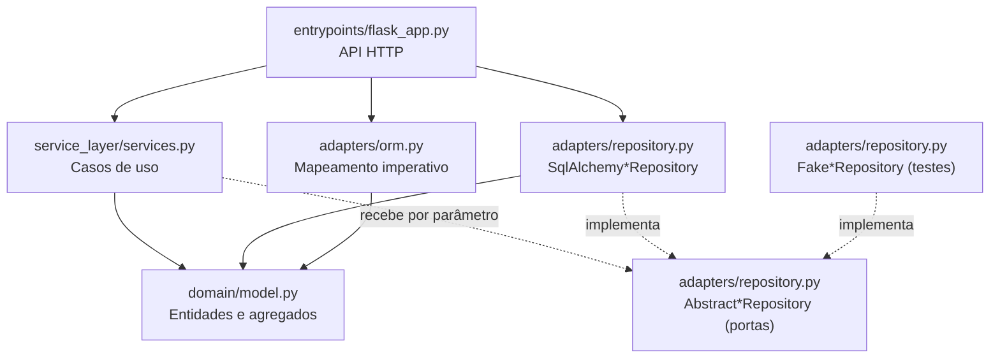

# Arquitetura do SorvGest

## 1. Escopo

O SorvGest é um sistema de gestão para uma sorveteria. Ele controla o catálogo de
sabores e seu estoque, os pedidos de venda (abertura, inclusão de itens, finalização
com baixa de estoque e cancelamento) e um programa de fidelidade em que clientes
acumulam pontos a cada compra e os resgatam depois. Os usuários são os atendentes,
que registram pedidos no balcão, e o gerente, que cadastra sabores, repõe estoque e
gerencia clientes. O acesso é feito por uma API HTTP.

## 2. Requisitos arquiteturais

### 2.1 Atributos de qualidade

**QA1 — Integridade das regras de negócio**

| Parte do cenário | Descrição |
|---|---|
| Fonte | Atendente |
| Estímulo | Tenta finalizar um pedido com quantidade maior que o estoque do sabor, ou resgatar mais pontos do que o saldo do cliente |
| Ambiente | Operação normal |
| Artefato | Agregados `Pedido`, `Sabor` e `ContaFidelidade` |
| Resposta | A operação é rejeitada com um erro de negócio (HTTP 400) e nenhum dado é alterado |
| Medida | 100% das violações rejeitadas; estoque e saldo nunca ficam negativos, verificado por testes unitários e e2e |

**QA2 — Testabilidade**

| Parte do cenário | Descrição |
|---|---|
| Fonte | Desenvolvedor |
| Estímulo | Altera uma regra de negócio (por exemplo, o cálculo de pontos) e executa os testes |
| Ambiente | Desenvolvimento, sem banco de dados configurado |
| Artefato | Domínio e camada de serviço |
| Resposta | Os testes de domínio e de serviço rodam sem banco, usando repositórios falsos |
| Medida | Suíte unitária completa em menos de 1 segundo; nenhum teste unitário depende do SQLite |

**QA3 — Modificabilidade**

| Parte do cenário | Descrição |
|---|---|
| Fonte | Gerente da sorveteria |
| Estímulo | Pede uma mudança de infraestrutura (trocar SQLite por PostgreSQL) ou um novo caso de uso |
| Ambiente | Manutenção |
| Artefato | Camadas `adapters/`, `service_layer/` e `entrypoints/` |
| Resposta | A mudança fica restrita às camadas externas, sem tocar no domínio |
| Medida | Zero linhas alteradas em `domain/model.py` para trocar o banco; um novo caso de uso altera no máximo 2 arquivos de produção (`services.py` e `flask_app.py`) |

### 2.2 Restrições

- Stack imposta pela disciplina: Python 3, Flask, SQLAlchemy e pytest.
- Estrutura de pastas do Apêndice B do livro-texto.
- Banco SQLite, sem servidor de banco dedicado e escolhido por não exigir um servidor.

### 2.3 Objetivos da arquitetura

- Manter as regras de negócio isoladas de frameworks, para que possam ser testadas
  e alteradas sem depender de banco ou HTTP.
- Ter uma ampla base de testes rápida que sirva de rede de segurança para as refatorações.
- Permitir trocar detalhes de infraestrutura, aumentar o escopo ou refatorar o código sem reescrever o domínio.

## 3. Arquitetura atual

### 3.1 Estilos e padrões adotados

- **Arquitetura em camadas**, com dependências apontando para dentro: entrypoints →
  serviços → domínio.
- **Ports & Adapters (parcial):** os repositórios abstratos são portas; as
  implementações SQLAlchemy e fake são adaptadores.
- **Domain Model:** as regras ficam nas entidades e agregados (`Pedido`, `Sabor`,
  `ContaFidelidade`), não nos serviços.
- **Repository:** um repositório por agregado, com três implementações cada
  (abstrata, fake em memória e SQLAlchemy).
- **Service Layer:** cada caso de uso é uma função em `services.py` que busca
  objetos nos repositórios, chama o domínio e confirma a transação.
- **Data Mapper com mapeamento imperativo:** `orm.py` liga tabelas às classes de
  domínio de fora para dentro; o domínio não importa SQLAlchemy.

### 3.2 Diagrama de componentes

As setas indicam "depende de". Nenhuma seta sai de `domain/`: o domínio não conhece
nenhuma outra camada. `services.py` importa apenas o domínio; os repositórios chegam
como parâmetros, o que permite usar os fakes nos testes.

### 3.3 Mapeamento para as pastas

| Componente | Pasta / arquivo | Responsabilidade |
|---|---|---|
| Domínio | `src/sorvgest/domain/model.py` | Entidades, objetos de valor, agregados e invariantes |
| Portas e repositórios | `src/sorvgest/adapters/repository.py` | Persistência por agregado (abstrato, fake e SQLAlchemy) |
| Mapeamento ORM | `src/sorvgest/adapters/orm.py` | Tabelas e ligação com as classes de domínio |
| Serviços | `src/sorvgest/service_layer/services.py` | 8 casos de uso e coordenação entre agregados |
| API | `src/sorvgest/entrypoints/flask_app.py` | Traduz HTTP em chamadas de serviço e erros em 400/404 |
| Testes | `tests/unit`, `tests/integration`, `tests/e2e` | Domínio e serviços; repositórios reais; API |