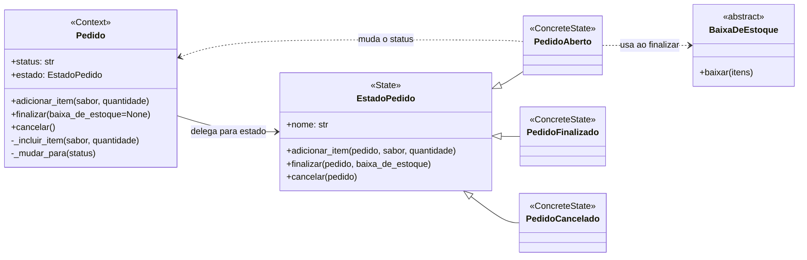

# Padrão GoF: State

## 1. Nome e categoria

**State**, padrão **comportamental**. Permite que um objeto mude de comportamento
quando o seu estado interno muda, como se mudasse de classe.

## 2. Contexto e problema

O `Pedido` tem um ciclo de vida: começa **aberto** e termina **finalizado** ou
**cancelado**. O que ele pode fazer depende disso: só um pedido aberto aceita
itens, pode ser finalizado ou pode ser cancelado.

Antes do padrão, essa regra estava espalhada em três métodos, cada um com o seu
próprio `if self.status != StatusPedido.ABERTO` (versão do commit `4d71bfb`):
`adicionar_item`, `finalizar` e `cancelar`. Isso traz dois problemas:

- **A regra de cada status não tem um lugar próprio.** Para saber o que um pedido
  finalizado pode fazer, é preciso ler os três métodos.
- **Um status novo exige mexer em todos os métodos.** Um requisito plausível para a
  sorveteria é o status **EM_PREPARO**: o pedido já foi pago e está sendo montado,
  não aceita mais itens, mas ainda pode ser cancelado com reembolso. Com os `if`,
  seria preciso alterar e retestar cada método do `Pedido`.

## 3. Por que este padrão

O problema é de **ciclo de vida**: o comportamento muda conforme o momento do
pedido, e é o próprio pedido que muda de estado ao ser finalizado ou cancelado.
É exatamente o problema que o State resolve.

**Alternativas consideradas:**

- **Manter os `if` com um `Enum`.** Mais simples para três status, mas a regra
  continuaria espalhada e cada status novo exigiria editar todos os métodos.
- **Strategy.** Tem a mesma estrutura de classes, mas resolve outro problema:
  algoritmos trocáveis escolhidos por quem está de fora. Aqui não há escolha
  externa; as transições (aberto → finalizado) são internas ao pedido. Além disso,
  a `BaixaDeEstoque` da refatoração SOLID (`docs/solid.md`) já tem a forma de um
  Strategy; usar o mesmo padrão de novo repetiria a ideia. O Strategy faria sentido
  em outra parte do sistema, como no cálculo dos pontos de fidelidade.

## 4. Participantes

| Papel no padrão | Classe no código | Responsabilidade |
|---|---|---|
| Context | `Pedido` | Guarda o `status`, obtém o estado atual (`estado`) e repassa a ele as operações |
| State | `EstadoPedido` | Define as operações; por padrão, recusa todas |
| ConcreteState | `PedidoAberto` | Permite incluir itens, finalizar (com a `BaixaDeEstoque`) e cancelar |
| ConcreteState | `PedidoFinalizado` | Não permite nada (herda as recusas) |
| ConcreteState | `PedidoCancelado` | Não permite nada (herda as recusas) |

Todos ficam em `src/sorvgest/domain/model.py` (commit `0ab6418`). O `status`
continua sendo um texto, porque é ele que o ORM grava no banco; o estado é obtido
a partir dele pelo dicionário `_ESTADOS`. Assim, o padrão não exigiu nenhuma
mudança em `orm.py` nem nos repositórios. Como os estados não guardam dados
próprios, cada um tem uma única instância, compartilhada por todos os pedidos.

## 5. Diagrama de classes

## 6. Testes

Os testes do padrão estão em `tests/unit/test_estado_pedido.py` (8 casos):

- um pedido novo começa em `PedidoAberto`;
- finalizar leva a `PedidoFinalizado` e cancelar leva a `PedidoCancelado`;
- nos dois estados encerrados, adicionar item, finalizar e cancelar são recusados
  (teste parametrizado, que roda para os dois estados);
- o estado aberto continua validando os itens;
- o estado é obtido a partir do `status` gravado, como acontece ao carregar do banco;
- os estados são compartilhados entre pedidos.

Além disso, os 26 testes da Fase 1 e os 4 da refatoração SOLID continuaram
passando sem alteração, assim como os de serviço, integração e e2e: a suíte foi
de 60 para 68 testes.

## 7. Custo

- **Mais classes:** quatro classes novas e um dicionário para três status;
  63 linhas adicionadas e 18 removidas em `model.py` (saldo de 45 linhas), além de
  79 linhas de testes novos. Para três status simples, os `if` eram mais curtos.
- **Lógica espalhada em mais lugares:** para entender a finalização, é preciso ler
  o `Pedido`, o `PedidoAberto` e a `BaixaNoSabor`.
- **Métodos "privados" usados de fora:** os estados chamam `_incluir_item` e
  `_mudar_para` do `Pedido`. Em Python isso é só uma convenção, mas indica que
  estado e contexto estão acoplados.

**Por que compensa:** cada regra de status passa a ter um lugar único, e o status
EM_PREPARO da seção 2 seria uma classe nova (`PedidoEmPreparo`) mais uma entrada
no `_ESTADOS`, sem alterar os métodos do `Pedido`.